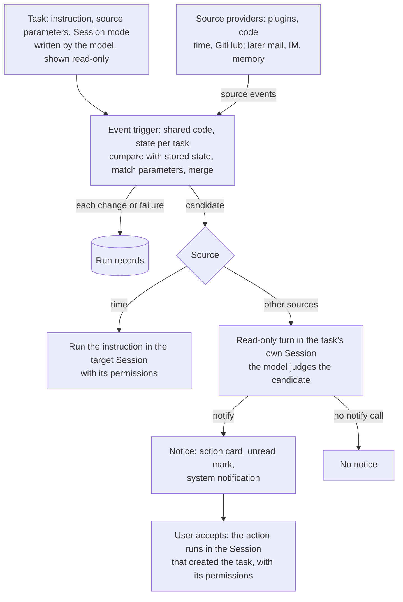

# Agent Note: Event-triggered automation tasks

Status: proposed

English | [中文](2026-10-29-event-triggered-automation-tasks.zh.md)

## Problem

Automation tasks run only on time rules today. The Host stores each rule, and every due time queues the task's instruction as a follow-up message in the task's original Session ([Host-owned scheduled messages](../../implemented/architecture/2026-09-16-host-schedule-storage.md)); the model creates and edits tasks through preset-scoped tools ([Preset-scoped Schedule tools](../../implemented/architecture/2026-09-24-preset-scoped-schedule-tools.md)). Work that should start when something else changes, such as a pull request's checks failing, a reviewer requesting changes, or a message arriving, cannot be expressed as a task, so users check those sources by hand across Sessions.

Reacting to changes brings two problems that time rules do not have.

- **Cost and noise.** Most observations of a source contain nothing worth a model turn. If every observation reaches the model and silence depends on the model replying with a marker, each poll costs a full turn, and a model that holds a messaging tool reports "nothing new" anyway.
- **Untrusted input.** Event content is written by other people: comments, reviews, messages. A turn started by that content must not edit, push, or send anything before the user has seen it.

## Proposal

An automation task becomes an instruction, a source with parameters, and a Session mode. Time is one source among several, so a scheduled task is an automation task whose source is time. Each observation passes three layers, and only the last one calls a model: a source event passes the trigger's filter and becomes a candidate, the candidate is delivered to a Session where the model judges it, and only a notify call produces a notice for the user. This partially supersedes the two notes linked above: tasks stop being bound to their original Session, and task records stop meaning inbox delivery only.

| Layer | Decides | Model call | Output |
|---|---|---|---|
| Source provider | What changed in the source | No | Events |
| Event trigger | Whether the change matters to this task | No | A run record; a candidate or nothing |
| Agent | Whether the user needs to act, and what to propose | Only for delivered candidates | A notice through notify, or nothing |

### Layers

**Source providers** are code, packaged as plugins; they provide event sources and are unrelated to model, SSH, or credential providers. A provider owns one kind of source: it polls or subscribes, reports changes as events with a subject, a one-line summary, detail, and links, and declares the JSON schema of the parameters a task can set. One provider serves every task of its kind. Time is the first provider, and today's schedule rules become its parameters. Any installed plugin can register a provider, including one written in Creator mode; a task can name only a registered provider.

**The event trigger** is shared code, registered per source kind and version; each task holds only its parameters and the source state it last observed. For each observation it compares the new state with the stored one, and an observation without a change only updates the last-checked time. A check that turns from passing to failing is a change, a check that stays failing is not, and a pass followed by a new failure is a change again. For a change, the trigger matches the task's conditions, which are parameter fields such as conclusion is failure, author is the user, or commenter is not a bot; merges changes to the same subject inside the provider's merge window, so one push that fails three checks becomes one event; stores the new state with the task; and either delivers a candidate to the Session or drops the change. Each change and each failure writes a run record, listed in the task's Records tab next to today's delivery records: candidate delivered, filtered with its reason, or failed. Consecutive failures with the same cause share one record with a count. Delivery ends the trigger's work: it does not wait for the turn or read a receipt. One queue per task orders its evaluations.

**The agent** receives the candidate as a message in the target Session, together with the task's instruction in the user's words. What the turn may do depends on the source.

- **Time**: the turn runs the instruction with the Session's permissions, and its reply is the result, as scheduled tasks behave today.
- **Other sources**: the turn gets the read-only tool set described under Mechanisms. It can read files and the source's state, such as check logs and pull request diffs, but has no tool that edits, pushes, or sends. One new tool, **notify** (`automation_notify`), takes a title, a summary, and a proposed action and produces a notice: an [action card](../../../../packages/experimental/action-cards/README.md) with the proposed action in the Session, the Session's unread mark, and a desktop system notification. The model decides whether to call it. A turn without notify produces no notice; there is no end tool, and nothing checks how the turn ended. When the user accepts the card, the Host sends a follow-up to the Session that handles the task, as described under Sessions; the follow-up names the task and the event and quotes the proposed action as the automation's proposal, not as the user's words, and that turn runs with that Session's permissions.

### Sessions

A task delivers to its target Session in one of three modes: a specified Session, a new Session per trigger, or a new Session on the first trigger that later triggers reuse. Time tasks keep today's target, the Session they were created in. Event tasks separate judging from handling. The read-only turn runs in the task's own Session, created on the first trigger and reused afterwards, because it needs the instruction, the event, and the task's earlier decisions rather than the long history of the conversation the task came from. When the model creates a task in a conversation, it writes the facts the judgment needs into the instruction, such as which check is known to be flaky. When the user accepts a card, the proposed action goes to the Session the task was created in, where the code and its history are. The automation page's New action already creates tasks in a new Session, which then handles them; a task enabled from an official template, which a later step adds, continues in its own Session. The user can change the mode on the task.

No task runs while the Host is stopped. On restart, each task compares the current source state with its stored state once and does not replay intermediate changes. Time keeps today's rule: a recurring task runs its latest missed occurrence once.

### Configuration

Configuration has two layers. Provider code decides what can be observed and how; task parameters decide what one task watches. The model writes the parameters from the user's words through the task tools, and the provider's schema validates them. A task carries no scripts or other code, so observing something new means changing or installing a provider plugin. The automation page shows source parameters read-only, and they change through conversation; the time editor stays.

### Mechanisms

- **Event-turn tool set.** Sandbox read-only mode limits only the filesystem, so it cannot stop a push or an outbound request. An event turn is offered a fixed tool set instead of the Session's: file reads and searches, the source provider's read operations, and `automation_notify`. Shell, file writes, web fetch, and MCP tools are absent. The tool set is recorded in the Session log, and a user message queued during the turn starts a normal turn after it ends.
- **Notify card.** The automation package registers an action-card kind, and `automation_notify` creates its card through the action-card service; the tool exists only in event turns, so no skill load precedes it. Accepting runs the kind's handler, which queues the follow-up through the Host, so the handling Session need not be open. A newer card replaces an unanswered older one in the same Session, as the service does today; the older card is in that Session's history, so the newer turn sees it and carries over what is still open. A refused card returns an error to the turn.
- **Unread mark.** The client derives the unread mark from turn completion. A task's own Session is marked as an automation Session, and for such a Session the client shows the mark only for notices, so a turn without notify leaves no mark.
- **Logging.** The delivered candidate, the turn's tool set, and the notify call are Session events, so replay rebuilds the turn; the TypeScript and Python SDK expected outputs and a recorded-session snapshot cover them.
- **Storage.** Source, parameters, Session mode, trigger state, and run records extend the Host task domain in a new record version with an adjacent migration. A version-1 task reads as a time task, is not rewritten until it changes, and gets no invented records. Run records have their own count and age bounds, separate from delivery records.
- **Provider configuration.** Polling intervals and request budgets are validated Config fields of each provider in cordis.yml.

### Product scope

- No new entry point and no page redesign: scheduled and event-triggered tasks share the automation page.
- The task list adds a source-type filter next to the status filter.
- Task details add the source with its parameters, read-only, and the Session mode, editable.
- A task's Records tab also lists filtered and failed evaluations.
- Notifications reuse the Session unread mark and action cards; the desktop app adds a system notification.

### Event triggers as infrastructure

The trigger layer is shared infrastructure for DSH, not a feature of the automation page. A feature that watches something and hands changes to an agent becomes a task on this layer instead of building its own polling, state, records, and notifications.

- **DSH's own state as sources**: a Session turn ending in an error, a background job settling, and, once memory lands, a memory consolidation pass finishing or memory entries changing.
- **Features on those sources**: plugin recommendations, where a workflow the user repeats by hand shows up after consolidation and the agent proposes a plugin on an action card, and task recommendations, where a review of the day's Sessions proposes follow-up work. Each is a template task with a DSH source, an instruction, and the same notify step. The plugin recommendations package, which proposes cards from conversation turns today, can move onto such a source once consolidation lands.
- **What every consumer keeps**: change detection and condition matching in code, run records, Session modes, read-only event turns, and notify as the only way a task reaches the user.

### Delivery order

1. Task–Session decoupling with the three Session modes.
2. The trigger layer with time as its first provider and the task-domain migration; existing scheduled tasks behave as before.
3. The GitHub provider for pull request checks, reviews, and comments; the event-turn tool set and `automation_notify`; action cards leave experimental status or ship with the automation bundle.
4. Mail and IM providers and official templates, then DSH's own sources.

## Alternatives considered

**Judge every observation in a resident Session.** The model reads each poll and replies with a silence marker when nothing changed. It lost because each observation costs a full turn over the Session's context, polls spaced beyond the prefix cache lifetime read that context uncached, and silence depends on the model following an instruction while it holds a messaging tool. Here code drops unchanged and unmatched observations, and only a notify call reaches the user.

**Judge in the Session that created the task.** That conversation already holds the code and its history, so the instruction would need no extra facts. It lost because most candidates produce no notice, and each of them would add a turn over the conversation's whole context, read uncached once the prefix cache has expired, and queue behind or interrupt the user's own work there. Only accepted work goes to that Session.

**Let the agent choose the Session for each event.** The choice could differ from one event to the next, so the user could not predict where a notification appears, and deciding whether the history is needed requires reading it first.

**Condition scripts per task.** A task would carry a script that fetches and decides. It lost because the script runs with the user's credentials without the review a plugin installation gets, and each task would carry its own fetch logic instead of sharing a provider.

**Notify from code when code can decide.** A failed check could notify without a model. It lost because the notification would carry only the raw status. With one path, the agent reads the logs first and the notification states the cause; change-only delivery keeps these turns rare.

**One model call outside any Session.** A single call per event costs less and leaves no Session record. It lost because the call cannot read files or logs before deciding, and acting on its result needs a Session anyway.

**Event turns with the Session's permissions.** Acting directly would save one click. It lost because event content comes from other people, and a read-only turn keeps that text from driving edits, pushes, or messages before the user accepts.

**A read-only sandbox for event turns.** It lost because sandbox read-only mode limits only the filesystem, and a turn in it can still push or send requests.

**An end tool and a check on how the turn ended.** A second tool would record why a turn produced no notice, and the trigger would wait for that outcome. It lost because nothing acts on that reason: delivery ends the trigger's work, and a turn without notify is already silent.

**Parameter forms on the automation page.** Each provider would need its own form, validation, and display. Parameters written by the model and shown read-only cover creation and change through conversation, and the provider schema keeps a generated form possible later.

**A separate notification entry.** An inbox page or tab would separate the notification from the Session that holds its context. The unread mark and the system notification lead to that Session, and the automation page keeps the records.

## Acceptance criteria

- Existing scheduled tasks behave the same after time becomes a provider: the same due times, the same catch-up rule, and the same delivery into the Session.
- A version-1 task loads as a time task without being rewritten and without invented records.
- A GitHub task on a pull request's checks delivers one candidate when a check turns from passing to failing, none while it stays failing, and another after a pass followed by a new failure.
- One push that fails three checks produces one candidate.
- An observation without a change writes no record and starts no turn; a change that fails the conditions writes a filtered record and starts no turn; consecutive failures with the same cause write one record with a count.
- A run record ends at delivery: it records the candidate, not what the turn did.
- An event turn is offered no shell, file-write, web-fetch, or MCP tool, and its tool set appears in the Session log; after the user accepts its card, the next turn runs with the Session's permissions.
- A notify call produces the card, the unread mark, and the desktop system notification together.
- An event turn without a notify call leaves no unread mark and sends no system notification.
- An event task's read-only turns run in the task's own Session, and accepting its card sends the proposed action to the Session the task was created in.
- Each Session mode delivers as defined: a specified Session receives every trigger, a new Session opens per trigger, or one Session opens on the first trigger and is reused.
- Replaying the Session log rebuilds an event turn's candidate, tool set, and notify call.
- After a restart, a task compares the current source state with its stored state once and does not replay intermediate changes.
- The task list filters by source type, task details show source parameters read-only, and the Session mode can be changed.

## Risks

- The read-only turn sees the instruction, the event, and the task's earlier decisions, not the conversation the task came from. Facts the judgment needs from that conversation must be written into the instruction when the task is created; a user who switches the task to its original Session gets the history back at the cost of reading the long context on each delivery.
- A notification appears in the task's own Session, not in the conversation that created the task; accepting its card moves the work to that conversation.
- The agent may notify too often or stay silent when it should not. Accepted and dismissed cards show over-notification, but a missed notice leaves no trace in the run records, which end at delivery.
- Source parameters cannot be edited by hand; every change goes through the model.
- A fix on an event waits for the user to accept the card instead of running unattended.
- A source without a provider plugin cannot be watched.
- Tasks run only while the Host runs: nothing runs while the app is closed or the machine sleeps.
- Event tasks depend on action cards, which are experimental and mounted only by the Personalized recommendations bundle today.
- The read-only tool set limits judgment to what files and the provider's read operations show; for a source whose provider offers no read operations, the agent judges from the event alone.
