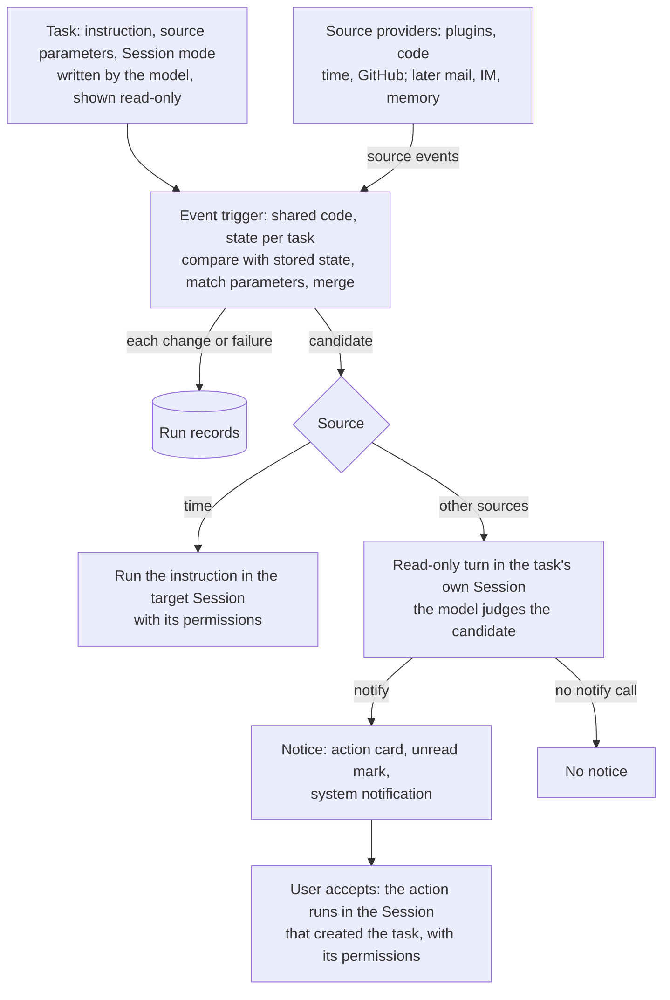

# Agent Note: 事件触发的自动化任务

Status: proposed

[English](2026-10-29-event-triggered-automation-tasks.md) | 中文

## 问题

目前自动化任务只能按时间规则运行。Host 保存每条规则，每到一个到期时间，就把任务的指令作为一条后续消息排进任务的原会话（[Host 拥有的定时消息](../../implemented/architecture/2026-09-16-host-schedule-storage.zh.md)）；模型通过按 preset 提供的工具创建和修改任务（[按 preset 提供的 Schedule 工具](../../implemented/architecture/2026-09-24-preset-scoped-schedule-tools.zh.md)）。有些工作应当在别处发生变化时开始，例如 PR（Pull Request）的检查失败、评审人要求修改、收到一条消息，这些都无法建成任务，用户只能在多个会话之间手动查看这些来源。

响应变化会带来两个时间规则没有的问题。

- **成本和噪音。** 对来源的大多数观察里，没有值得花一个模型轮次处理的内容。如果每次观察都交给模型，并依靠模型回复一个标记来保持安静，每次轮询都要花一个完整轮次；手里有发消息工具的模型仍然会报告“没有新情况”。
- **不可信的输入。** 事件内容由其他人写成：评论、评审、消息。由这类内容启动的轮次，在用户看到之前不能修改、推送或发送任何东西。

## 提案

自动化任务改为由指令、带参数的来源和会话模式组成。时间是多种来源中的一种，因此定时任务就是来源为时间的自动化任务。每次观察依次经过三层，只有最后一层调用模型：来源事件经过触发器过滤成为候选事件（candidate），候选事件投递到会话，由模型在会话中判断，只有调用通知工具才会为用户产生一条通知（notice）。本提案部分取代上面链接的两篇笔记：任务不再绑定原会话，任务记录也不再只表示收件箱投递。

| 层 | 判断什么 | 是否调用模型 | 输出 |
|---|---|---|---|
| 来源提供方（source provider） | 来源里发生了什么变化 | 否 | 事件 |
| 事件触发器（event trigger） | 这个变化与本任务是否相关 | 否 | 一条运行记录；一个候选事件，或者没有 |
| agent（智能体） | 用户是否需要处理，以及建议怎么处理 | 只对已投递的候选事件 | 通过通知工具产生通知，或者没有 |

### 分层

**来源提供方**是代码，以插件形式提供；它们提供事件来源，与模型、SSH 或凭据的提供方无关。一个来源提供方负责一类来源：它轮询或订阅来源，把变化报告为事件（包含对象、一行摘要、详细内容和链接），并声明任务可设置参数的 JSON schema。同类的所有任务共用同一个来源提供方。时间是第一个来源提供方，现有的定时规则成为它的参数。任何已安装的插件都可以注册来源提供方，包括在创造模式中写出的插件；任务只能指定已注册的来源提供方。

**事件触发器**是共享的代码，按来源类型和版本注册；每个任务只保存自己的参数和上次观察到的来源状态。每次观察时，它把新状态与保存的状态比较；没有变化的观察只更新最近检查时间。检查从通过变为失败算一次变化，持续失败不算，通过之后再次失败又算一次变化。对一次变化，触发器先匹配任务的条件（参数中的字段，例如结论为失败、作者是用户本人、评论者不是 bot），再在来源提供方的合并窗口内合并同一对象的多次变化（一次推送导致三项检查失败，只算一个事件），然后把新状态和任务一起保存，向会话投递一个候选事件，或者丢弃这次变化。每次变化和每次失败都写一条运行记录，列在任务的运行记录页签中，与现有的投递记录并列：已投递候选事件、已过滤（附原因）或失败。同一原因的连续失败共用一条记录并计数。投递之后触发器的工作就结束了，不等待该轮次，也不读取回执。每个任务用一个队列排定自己的判定顺序。

**agent** 在目标会话中以一条消息收到候选事件，消息附带以用户原话写成的任务指令。轮次能做什么取决于来源。

- **时间**：轮次按会话的权限执行指令，回复就是结果，与现在的定时任务一致。
- **其他来源**：轮次使用“机制”一节所述的只读工具集。它可以读文件和来源的状态，例如检查日志和 PR diff，但没有修改、推送或发送的工具。新增一个工具 **通知**（`automation_notify`），接收标题、摘要和建议的操作，产生一条通知：会话中出现带有建议操作的[操作卡片](../../../../packages/experimental/action-cards/README.zh.md)、会话显示未读标记、桌面端发送系统通知。是否调用由模型决定。没有调用通知的轮次不产生通知；没有结束工具，也不检查轮次如何结束。用户接受卡片后，Host 向处理该任务的会话（见“会话”一节）发送一条后续消息：消息写明任务和事件，并把建议的操作作为自动化提出的建议引用，而不是作为用户的话；该轮次按该会话的权限执行。

### 会话

任务按三种模式之一投递到目标会话：指定的会话、每次触发新建会话、首次触发时新建会话并在之后的触发中复用。定时任务沿用现在的目标，即创建它的会话。事件任务把判断和处理分开。只读轮次在任务自己的会话中运行，首次触发时新建，之后复用，因为它需要的是指令、本次事件和该任务之前的判断，而不是任务来源会话的长历史。模型在会话中创建任务时，把判断需要的事实写进指令，例如哪项检查已知不稳定。用户接受卡片后，建议的操作发往创建任务的会话，代码和相关历史都在那里。自动化页的“新建”本来就在一个新会话中创建任务，之后由该会话处理；从官方模板启用的任务（后续步骤加入）在自己的会话中继续执行。用户可以在任务上修改模式。

Host 停止期间不运行任何任务。重启后，每个任务把当前来源状态与保存的状态比较一次，不重放中间的变化。时间沿用现有规则：周期任务只补跑最近一次错过的时间点。

### 配置

配置分两层。来源提供方的代码决定能观察什么、如何观察；任务参数决定一个任务观察什么。模型根据用户原话，通过任务工具写入参数，由来源提供方的 schema 校验。任务不携带脚本或其他代码，因此要观察新的东西，就修改或安装来源提供方插件。自动化页以只读方式显示来源参数，参数通过对话修改；时间编辑器保留。

### 机制

- **事件轮次的工具集。** 沙箱的只读模式只限制文件系统，挡不住推送或外发请求。因此事件轮次使用固定的工具集，而不是会话的工具集：读文件和搜索、来源提供方的读取操作，以及 `automation_notify`。没有 shell、写文件、网页抓取和 MCP 工具。工具集记录在会话日志中；轮次进行中排队的用户消息，在该轮次结束后作为普通轮次执行。
- **通知卡片。** 自动化包注册一种操作卡片类型，`automation_notify` 通过操作卡片服务创建这类卡片；该工具只在事件轮次中提供，因此调用前不需要加载 Skill。接受卡片时执行该类型的处理器，由处理器通过 Host 排入后续消息，所以处理任务的会话不必处于打开状态。同一会话中，新卡片会替换尚未处理的旧卡片，与操作卡片服务现在的行为一致；旧卡片在该会话的历史中，新的轮次能看到它，并把仍未处理的内容带到新卡片里。被拒绝的卡片会把错误返回给该轮次。
- **未读标记。** 客户端根据轮次完成推导未读标记。任务自己的会话标记为自动化会话，对这类会话，客户端只为通知显示未读标记，因此没有调用通知的轮次不留下标记。
- **日志。** 已投递的候选事件、轮次的工具集和通知调用都是会话事件，回放可以重建该轮次；TypeScript 和 Python SDK 的期望输出以及一个录制会话快照覆盖这些内容。
- **存储。** 来源、参数、会话模式、触发器状态和运行记录以新的记录版本扩展 Host 任务域，并提供相邻迁移。版本 1 的任务按时间任务读取，在发生修改前不重写，也不补造记录。运行记录有自己的数量和时长上限，与投递记录分开。
- **来源提供方配置。** 轮询间隔和请求额度是每个来源提供方在 cordis.yml 中经过校验的 Config 字段。

### 产品范围

- 不新增入口，不重做页面：定时任务和事件触发的任务共用自动化页。
- 任务列表在状态筛选旁增加来源类型筛选。
- 任务详情增加来源及其参数（只读）和会话模式（可修改）。
- 任务运行记录同时列出已过滤和失败的判定。
- 通知复用会话的未读标记和操作卡片；桌面端新增系统通知。

### 事件触发作为基础设施

触发层是 DSH 共用的基础设施，而不是自动化页的一项功能。需要观察某样东西并把变化交给 agent 的功能，都作为这一层上的任务实现，不再各自实现轮询、状态、记录和通知。

- **DSH 自身状态作为来源**：会话轮次以错误结束、后台作业结束；memory 落地后，还包括一次 memory 整理完成，或 memory 条目发生变化。
- **基于这些来源的功能**：插件推荐，即 memory 整理后发现用户反复手动执行的流程，由 agent 在操作卡片上推荐插件；任务推荐，即回顾当天的会话，提出后续要做的事。每一项都是一个模板任务，由一个 DSH 来源、一条指令和同样的通知步骤组成。插件推荐包现在从对话轮次中提出卡片，memory 整理落地后可以改为基于这类来源。
- **每个使用方都保留的规则**：变化检测和条件匹配由代码完成、运行记录、会话模式、只读的事件轮次，以及只有通知能让任务触达用户。

### 交付顺序

1. 任务与会话解耦，支持三种会话模式。
2. 上线触发层和任务域迁移，以时间作为第一个来源提供方；现有定时任务行为不变。
3. GitHub 来源提供方，覆盖 PR 的检查、评审和评论；事件轮次工具集和 `automation_notify`；操作卡片结束实验状态，或随自动化 bundle 一起提供。
4. 邮件和 IM 来源提供方以及官方模板，然后是 DSH 自身的来源。

## 考虑过的替代方案

**在常驻会话中判断每次观察。** 模型读取每次轮询的结果，没有变化时回复一个静默标记。没有采用，原因是：每次观察都要在会话的完整上下文上花一个轮次；轮询间隔超过前缀缓存的有效期时，每次都要在没有缓存的情况下读取整个上下文；而且模型手里有发消息工具时，能否保持安静取决于它是否遵守指令。本方案由代码丢弃没有变化和不匹配的观察，只有调用通知才会触达用户。

**在创建任务的会话中判断。** 该会话已经有代码和相关历史，指令里不需要额外写事实。没有采用，原因是大多数候选事件不产生通知，每一次都会在该会话的完整上下文上增加一个轮次，前缀缓存过期后要在没有缓存的情况下读取整个上下文，用户正在那里工作时还要排队或打断。只有被接受的工作才会进入该会话。

**由 agent 为每个事件选择会话。** 每次的选择可能不同，用户无法预料通知出现在哪里；而且要判断是否需要历史，得先读取历史。

**每个任务自带条件脚本。** 任务携带一个脚本，由脚本获取数据并作出判断。没有采用，原因是脚本以用户的凭据运行，却没有经过安装插件时的审查；而且每个任务都要自带获取逻辑，无法共用来源提供方。

**代码能判断时由代码直接通知。** 检查失败可以不经模型直接通知。没有采用，原因是这样的通知只包含原始状态。只保留一条路径时，agent 会先读日志，通知中写明失败原因；只在变化时投递，这类轮次很少。

**在会话之外调用一次模型。** 每个事件调用一次模型，成本更低，也不留下会话记录。没有采用，原因是这次调用在判断前无法读取文件或日志，而且要根据结果采取行动仍然需要会话。

**事件轮次沿用会话的权限。** 直接行动可以省去一次点击。没有采用，原因是事件内容来自其他人，只读轮次能防止这些文字在用户接受之前驱动修改、推送或发消息。

**事件轮次使用只读沙箱。** 没有采用，原因是沙箱的只读模式只限制文件系统，处于该模式的轮次仍然可以推送或发出请求。

**结束工具和对轮次结束方式的检查。** 第二个工具可以记录某一轮为什么没有产生通知，触发器则要等待这个结果。没有采用，原因是没有任何环节会使用这个原因：投递之后触发器的工作就结束了，而没有调用通知的轮次本来就是静默的。

**在自动化页提供参数表单。** 每个来源提供方都需要各自的表单、校验和展示。由模型写入参数并以只读方式展示，已经覆盖通过对话创建和修改；来源提供方的 schema 让以后生成表单仍然可行。

**单独的通知入口。** 收件箱页面或标签页会把通知与持有其上下文的会话分开。未读标记和系统通知都指向该会话，自动化页保留记录。

## 验收标准

- 时间改为来源提供方后，现有定时任务行为不变：到期时间相同、补跑规则相同、投递到会话的方式相同。
- 版本 1 的任务按时间任务加载，不重写，也不补造记录。
- 观察 PR 检查的 GitHub 任务，在检查从通过变为失败时投递一个候选事件，持续失败期间不再投递，通过之后再次失败时再投递一个。
- 一次推送导致三项检查失败，只产生一个候选事件。
- 没有变化的观察不写记录，也不启动轮次；不满足条件的变化写一条已过滤记录，不启动轮次；同一原因的连续失败只写一条带计数的记录。
- 运行记录到投递为止：记录候选事件，不记录该轮次做了什么。
- 事件轮次不提供 shell、写文件、网页抓取或 MCP 工具，其工具集出现在会话日志中；用户接受卡片后，下一轮次按会话的权限执行。
- 一次通知调用同时产生卡片、未读标记和桌面端系统通知。
- 没有调用通知的事件轮次不留下未读标记，也不发送系统通知。
- 事件任务的只读轮次在任务自己的会话中运行；接受卡片后，建议的操作发往创建任务的会话。
- 每种会话模式按定义投递：指定的会话接收每次触发，或每次触发新建一个会话，或首次触发时新建一个会话并在之后复用。
- 回放会话日志可以重建事件轮次的候选事件、工具集和通知调用。
- 重启后，任务把当前来源状态与保存的状态比较一次，不重放中间的变化。
- 任务列表可以按来源类型筛选，任务详情以只读方式显示来源参数，会话模式可以修改。

## 风险

- 只读轮次看到的是指令、本次事件和该任务之前的判断，看不到任务来源的会话。判断需要的、来自那个会话的事实，必须在创建任务时写进指令；用户把任务改成投回原会话，就能拿回历史，代价是每次投递都要读取很长的上下文。
- 通知出现在任务自己的会话里，而不是创建任务的对话里；接受卡片后，工作转到那个对话。
- agent 可能通知过于频繁，或者在应该提醒时保持静默。被接受和被忽略的卡片能看出通知过多，但漏掉的通知不会在运行记录中留下痕迹，因为运行记录到投递为止。
- 来源参数不能手动编辑，每次修改都要经过模型。
- 针对事件的修复要等用户接受卡片，不会在无人值守时执行。
- 没有来源提供方插件的来源无法观察。
- 任务只在 Host 运行时执行：应用关闭或机器休眠期间不运行任何任务。
- 事件任务依赖操作卡片，而它目前是实验包，只由个性化推荐 Bundle 装入。
- 只读工具集把判断限制在文件和来源提供方读取操作能看到的内容；来源提供方不提供读取操作时，agent 只能根据事件本身判断。
